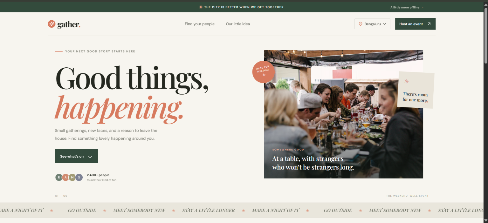

# Gather

Gather is a local event guide for finding something to do and meeting people nearby. Browse the listings, filter by category, save a spot, or share an event of your own.

**Live site:** [gather-api-n1kd.onrender.com](https://gather-api-n1kd.onrender.com)



## Features

- Browse upcoming events in Bengaluru
- Filter events by category
- RSVP by email and see current attendance
- Publish an event with its date, venue, host, price, and capacity
- Load a small set of sample events when the database is empty

## Built with

- React and Vite
- Node.js and Express
- MongoDB Atlas and Mongoose
- Render

## Run locally

You need Node.js 20 or newer and a MongoDB connection string. A local MongoDB instance or an Atlas cluster will work.

1. Install dependencies from the project root:

   ```sh
   npm install
   ```

2. Copy `server/.env.example` to `server/.env` and set `MONGODB_URI` to your database connection string. The other values in the example file are suitable for local development.

3. Start the client and API:

   ```sh
   npm run dev
   ```

4. Open the Vite address printed in the terminal. The client runs on port 5173 and sends `/api` requests to the Express server on port 5000.

## API

| Method | Path | Purpose |
| --- | --- | --- |
| `GET` | `/api/health` | Check the API and database connection |
| `GET` | `/api/events` | List upcoming events |
| `GET` | `/api/events/:id` | Get one event |
| `POST` | `/api/events` | Publish an event |
| `POST` | `/api/events/:id/rsvp` | RSVP to an event |

## Deploy on Render

The root `render.yaml` configures one web service for the client and API. To deploy from your own fork, connect the repository in Render and create a Blueprint from that file. Add `MONGODB_URI` as a secret environment variable in Render. In Atlas, allow connections from the service's outbound IP addresses.

Keep database credentials in environment settings. Do not put them in source files or commit them to Git.
